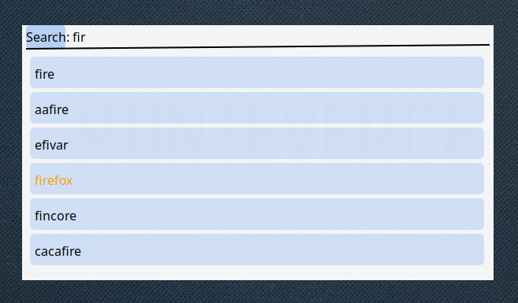

# Rex

Rex is a lightweight application launcher for X11, developed as part of the
**Monteverde Linux** distribution.



> **Status:** early development. Rex works, but it is missing features and has
> not been hardened for daily use yet.

## What it does

Rex opens a small undecorated window, scans every directory in your `$PATH`
for executables, and fuzzy-matches them as you type. Pick a result and press
Enter to launch it; Rex exits right after.

Matching ignores case and is fuzzy: the letters you type must appear in the
program name in order, but not necessarily next to each other, so `ffx`
matches `firefox`. Results are ranked exact match first, then names starting
with what you typed, then names containing it, then fuzzy matches; shorter
names come first within each group.

### Keys

| Key           | Action                               |
|---------------|--------------------------------------|
| Type          | Filter the list of programs          |
| `Up` / `Down` | Move the selection (wraps around)    |
| `Enter`       | Launch the selected program and exit |
| `Backspace`   | Delete the last character            |
| `Escape`      | Quit without launching anything      |

### Current limitations

- Launches executables from `$PATH` only; `.desktop` entries are not read.
- Programs are started without arguments.
- Input is limited to printable ASCII.
- X11 only (works under XWayland, but there is no native Wayland support).

## Building

### Dependencies

- CMake 3.16 or newer
- A C++17 compiler (GCC or Clang)
- pkg-config
- XCB: `xcb`, `xcb-keysyms`
- Cairo (with XCB support)
- Pango
- X11 protocol headers (for `X11/keysym.h`)

**Arch Linux**

```bash
sudo pacman -S cmake gcc pkgconf libxcb xcb-util-keysyms xorgproto cairo pango
```

**Debian / Ubuntu**

```bash
sudo apt install cmake g++ pkg-config libxcb1-dev libxcb-keysyms1-dev x11proto-dev libcairo2-dev libpango1.0-dev
```

**Fedora**

```bash
sudo dnf install cmake gcc-c++ pkgconf-pkg-config libxcb-devel xcb-util-keysyms-devel xorg-x11-proto-devel cairo-devel pango-devel
```

### Build and run

```bash
cmake -S . -B build -DCMAKE_BUILD_TYPE=Release
cmake --build build
./build/src/Rex
```

The build type defaults to `Debug` if you don't pass one.

To install (to `/usr/local/bin` by default):

```bash
sudo cmake --install build
```

Rex is meant to be bound to a hotkey in your window manager, for example
in i3:

```
bindsym $mod+d exec Rex
```

## Project layout

```
include/            Public headers
src/
  launcher.cpp      Entry point
  rex.cpp           Owns the X connection and runs the event loop
  ui.cpp            Window creation and drawing (XCB + Cairo + Pango)
  inputhandler.cpp  Keyboard handling and selection state
  suggestion.cpp    $PATH scanning and fuzzy matching
  executionengine.cpp  Launching the selected program
```

## License

Rex is licensed under the BSD 3-Clause License. See [LICENSE](LICENSE) for
details.
